# REALDEX (리얼덱스)

> 우리 동네 곤충과 새를 찍으면 AI가 알려 주고, 나만의 생물 도감에 모입니다.

현실의 곤충·새·동물을 촬영하면 AI(Claude 비전 모델)가 후보를 제시하고, 사용자가 확인한 생물이 **도감 카드**로 수집되는 모바일 앱입니다. 경험치·레벨·미션·카드 성장 같은 게임 요소로 반복 관찰을 유도합니다.

- **웹/PWA 데모**: https://ilrutto2-cmd.github.io/realdex/ — 휴대폰 브라우저로 열고 "홈 화면에 추가"하면 앱처럼 쓸 수 있습니다. 공개 데모는 **데모 모드**(AI 미연결, 촬영 후 생물을 직접 선택)로 빌드되어 사용료가 들지 않습니다.
- **Android APK**: [Releases](https://github.com/ilrutto2-cmd/realdex/releases)
- 스택: Expo SDK 58 (React Native 0.88) · TypeScript · Supabase (Postgres · Auth · Storage · Edge Functions) · Anthropic Messages API

## 화면

| 홈 | AI 판별 후보 | 새로운 발견 | 도감 | 카드 3단계 |
|---|---|---|---|---|
| 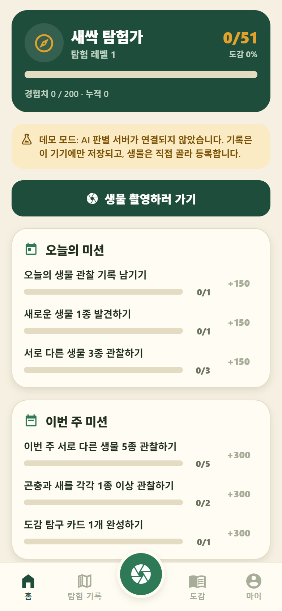 | 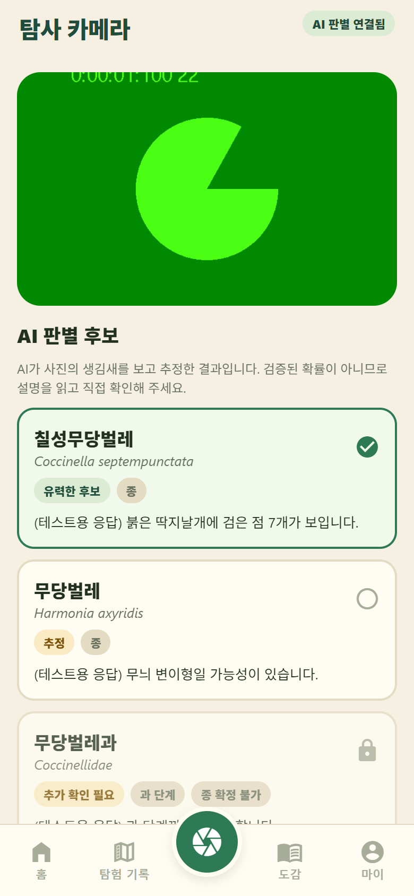 | 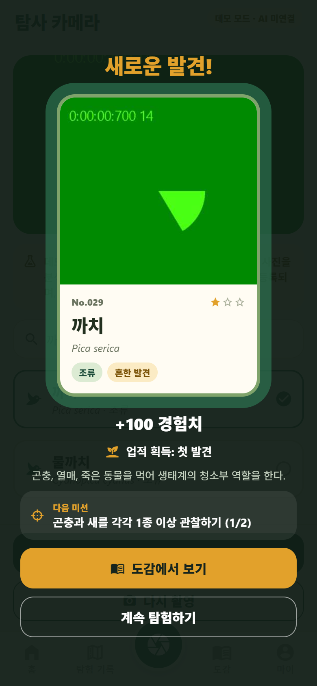 | 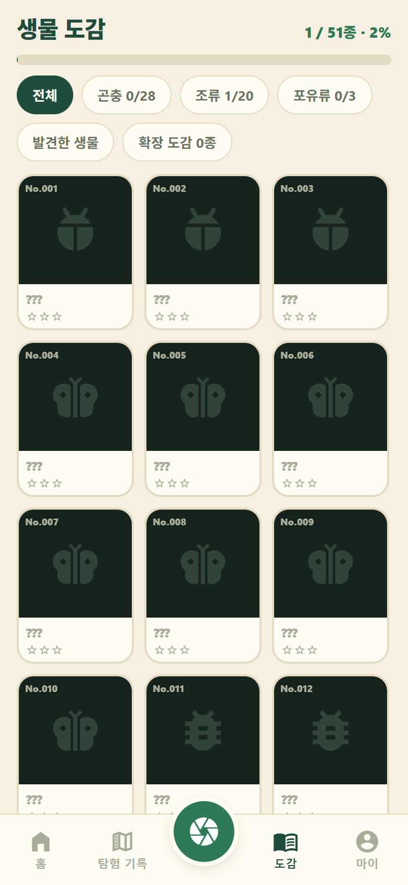 | 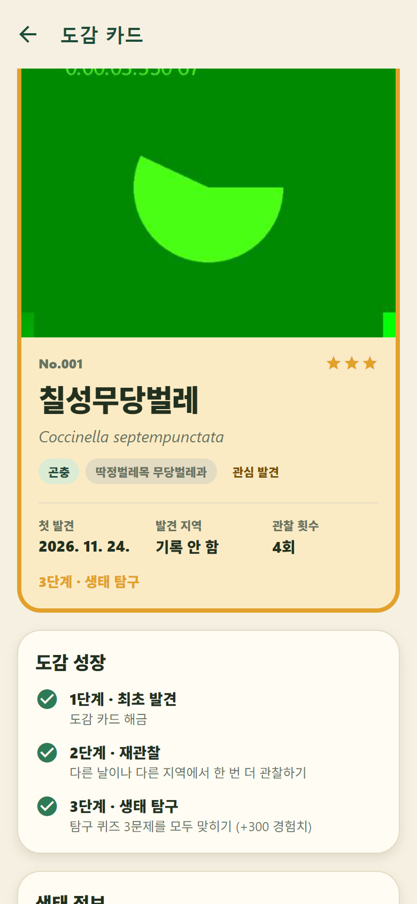 |

| 생태 탐구 퀴즈 | 미션 보상 | 마이 | 통신 오류 | 카메라 권한 거부 |
|---|---|---|---|---|
| 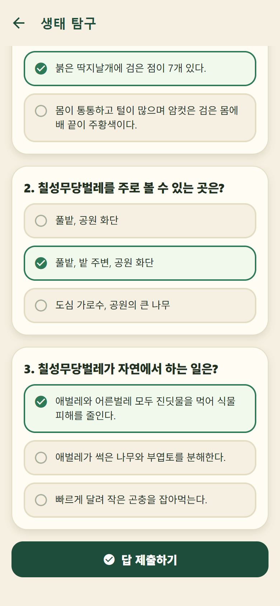 | 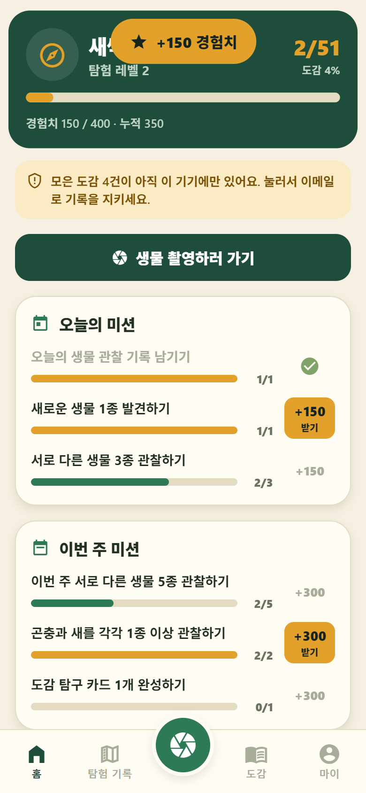 | 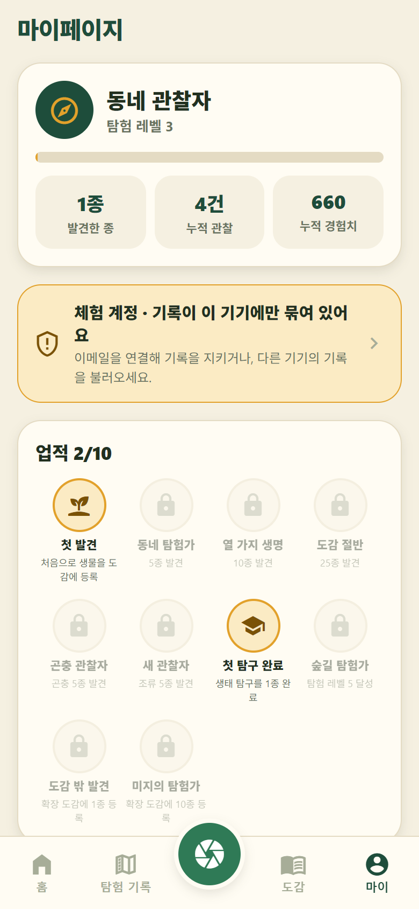 | 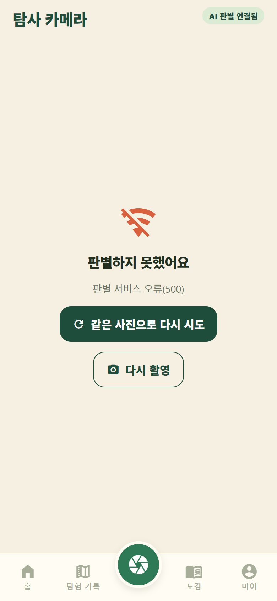 | 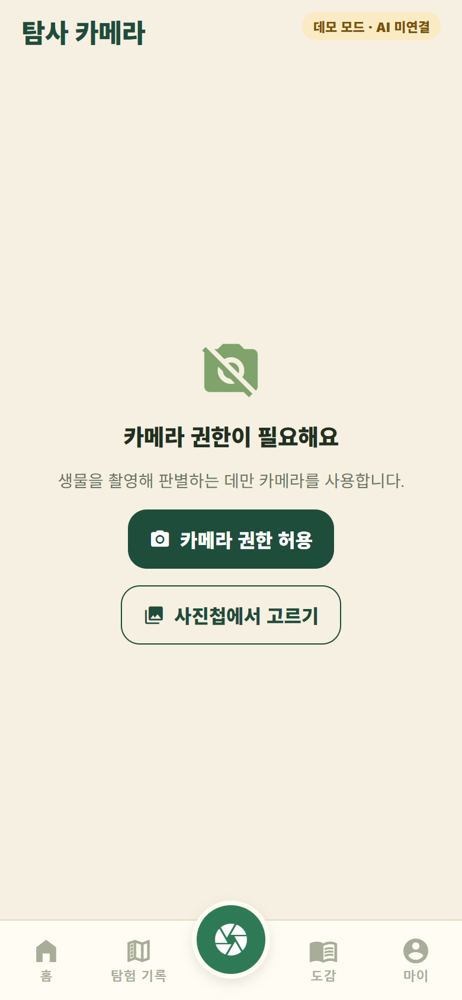 |

<sub>스크린샷은 종단 테스트(`npm run e2e`)가 웹 빌드를 헤드리스 크롬으로 조작하며 찍은 것입니다. 사진 영역의 초록 화면은 크롬의 **가짜 카메라** 영상이고, AI 판별 결과는 테스트용 고정 응답입니다.</sub>

## 주요 기능

- **촬영과 판별** — 카메라·사진첩 → 서버 함수가 Claude 비전 모델로 후보 최대 3개(국명·학명·판별 단계·근거)를 반환. 확률 숫자 대신 "유력한 후보 / 추정 / 추가 확인 필요"로만 표시하고, 종까지 확정되지 않으면 등록을 막습니다. 생물이 없거나 화면을 찍은 사진은 재촬영 안내, 보호종 가능성이 있으면 위치를 저장하지 않습니다.
- **도감** — 기본 51종(곤충 28·조류 20·포유류 3) + AI가 종까지 확실히 판별한 도감 밖 생물을 담는 **확장 도감**. 같은 종을 다시 찍으면 관찰 기록만 추가됩니다.
- **카드 성장** — 최초 발견 → 재관찰(다른 날/지역) → 생태 탐구(퀴즈 3문제) 3단계, 단계마다 테두리·별 변화.
- **게임** — 경험치·레벨·칭호, 업적, 일일/주간 미션. 보상마다 고유 키를 두어 중복 지급·같은 사진 재등록을 막습니다.
- **계정과 백업** — 처음엔 익명 계정으로 바로 사용, 이메일 6자리 코드로 계정을 연결하면 다른 기기에서 기록을 불러와 합칩니다.
- **후기 수집** — 의견 보내기, 판별 오류 신고, 토큰으로 보호되는 관리자 통계.

## 아키텍처

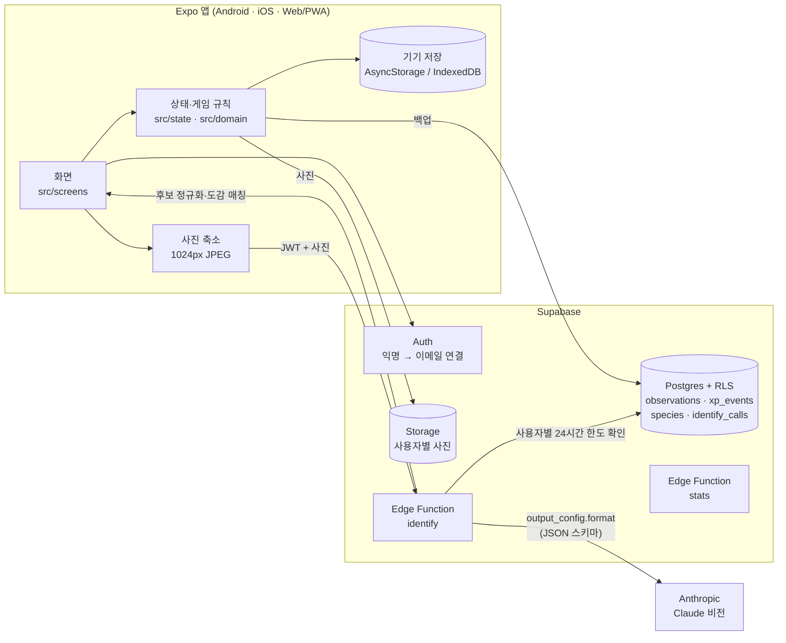

**설계 포인트**

- **AI 키는 서버에만** — 앱에는 Supabase 주소와 publishable key(공개용)만 들어가고, `ANTHROPIC_API_KEY`는 Edge Function 비밀값으로만 존재합니다. 앱은 사용자 JWT로 `identify` 함수를 호출하고, 함수가 인증·호출 한도(`IDENTIFY_DAILY_LIMIT`, 기본 40회/24시간)를 확인한 뒤 Claude를 부릅니다.
- **모델 응답은 믿지 않고 검증** — 모델 출력은 JSON 스키마로 형식을 강제한 뒤에도 `core.ts`에서 다시 정규화합니다. 모델이 준 도감 ID는 그대로 믿지 않고 도감 목록·학명과 다시 대조하며, 종 단계가 아니거나 목록에 없는 후보는 도감 등록 대상에서 뺍니다. 확장 도감은 '유력' 판정 + 종 단계 + 학명 형식이 모두 맞을 때만 허용합니다. 판별 로직은 Deno·Node 양쪽에서 돌아가는 순수 함수라 단위 테스트가 가능합니다.
- **오프라인 우선 저장** — 모든 기록은 기기에 먼저 저장되고 서버는 백업입니다. 서버가 없으면 데모 모드로 동작하며, 가짜 판별 결과를 만들지 않습니다.
- **행 수준 보안(RLS)** — 모든 사용자 테이블과 Storage 버킷은 `auth.uid()` 기준으로만 읽고 쓰도록 제한했고, `tests/sql/rls_test.sql`로 다른 사용자 데이터 접근이 막히는지 확인합니다.
- **개인정보 최소화** — 이름을 받지 않고, 위치 기록은 기본 꺼짐. 켜도 시·구 이름과 약 1km로 줄인 좌표만 저장합니다.

## 트러블슈팅

| 문제 | 원인 | 해결 |
|---|---|---|
| 판별 함수가 Anthropic에서 **400**을 받음 | 구조화된 결과를 받으려고 `tool_choice: { type: 'tool' }`로 도구 호출을 강제했는데, 사용한 모델이 강제 도구 호출을 지원하지 않음 | Messages API의 `output_config.format`(JSON 스키마)로 응답 형식을 강제하도록 변경. 응답의 `stop_reason === 'refusal'`도 실패로 처리 (`2db226f`) |
| 배포한 함수가 **서버 키를 못 찾음** | 새 Supabase 프로젝트는 `SUPABASE_SERVICE_ROLE_KEY` 대신 `SUPABASE_SECRET_KEYS`(JSON)를 주입 | 예전 형식과 새 형식을 모두 읽는 `serverKey()` 추가 (`4002e96`) |
| 판별 실패 시 앱에 "서비스 오류(4xx)"만 보여 **원인 파악 불가** | 업스트림 오류 본문을 버리고 상태 코드만 전달 | Anthropic 오류 본문에서 원인을 꺼내 로그에 남기고, 크레딧 부족·잘못된 키는 별도 문구로 안내 (`83d54b7`) |
| 실제 서버가 동작하는지 **배포 후 확인할 방법이 없음** | 로컬 테스트는 가짜 백엔드를 사용 | GitHub Actions `server-check` 워크플로: 익명 로그인 → 위키백과 사진으로 `identify` 호출 → 결과를 Job 요약에 기록. 비용이 드는 판별 단계와 비용 없는 설정 점검 단계를 분리 |
| AI가 만든 확장 종 설명에 **한자가 섞임** (예: '一年') | 프롬프트가 "한국어로"만 요구 | "한글로, 한자·다른 나라 문자를 섞지 않는다"로 프롬프트 수정 (`b49d293`) |
| APK 빌드가 **느리고 중복 실행** | 매번 Android SDK를 내려받고, 연속 푸시마다 빌드가 쌓임 | 러너에 미리 설치된 SDK 사용, `concurrency`로 이전 빌드 취소, 결과 APK를 Releases에 게시 |
| 종단 테스트가 **가끔 "이미 등록한 사진"으로 실패** | 크롬 가짜 카메라 영상이 반복되어 이전과 똑같은 사진이 찍히고, 앱이 중복 사진을 의도대로 막음 | 촬영 간격을 매번 다르게 하고, 중복이면 다시 찍는 재시도 로직 추가 (실제 카메라에서는 발생하지 않음) |
| 웹에서 **사진 수십 장 이후 저장 실패** 우려 | 웹의 AsyncStorage는 `localStorage`(약 5MB)를 사용 | 웹 저장소를 IndexedDB로 바꾸고, 계정 연결로 서버에 백업 (`6e20585`) |
| GitHub Pages(`/realdex/`)에서 **아이콘·manifest 404** | `index.html`·`manifest.json`이 `/manifest.json` 같은 루트 절대 경로를 사용 | 상대 경로로 바꾸고, Pages 빌드 때만 `experiments.baseUrl`을 저장소 이름으로 지정 |

## 테스트

| 검증 | 명령 | 결과 (2026-11-24 재실행) |
|---|---|---|
| 타입 검사 | `npm run typecheck` | 통과 |
| 단위 테스트 — 게임 규칙, 판별 응답 정규화, 기록 합치기 | `npm test` | **57개 통과** |
| 종단 테스트 — 웹 빌드를 헤드리스 크롬으로 조작 (데모 모드, 가짜 백엔드 연결, 계정 연결, 권한 거부) | `npm run build:e2e && npm run e2e` | **70개 통과** |
| DB 스키마·시드·RLS (로컬 PostgreSQL) | `npm run test:sql` | 이번 재실행에는 포함하지 않음 |

종단 테스트의 AI 응답은 **테스트용 고정값**입니다. 앱 ↔ 서버 함수 연결과 화면 흐름을 확인한 것이지, 판별 정확도를 측정한 것은 아닙니다. 실제 모델 동작은 `server-check` 워크플로로 별도 확인합니다.

## 실행 방법

**데모 모드 (설정 없음)**

```bash
npm install
EXPO_PUBLIC_SUPABASE_URL= EXPO_PUBLIC_SUPABASE_ANON_KEY= npx expo start   # Expo Go로 QR 스캔, 또는 w 키로 웹
```

**실제 AI 판별 연결**

1. Supabase 프로젝트를 만들고 Authentication에서 **Anonymous sign-ins**를 켭니다.
2. `supabase/migrations/0001~0003`과 `supabase/seed.sql`을 순서대로 실행합니다.
3. 함수 배포:
   ```bash
   supabase secrets set ANTHROPIC_API_KEY=<키> STATS_TOKEN=<12자 이상>
   supabase functions deploy identify
   supabase functions deploy stats
   ```
   선택: `IDENTIFY_MODEL`, `IDENTIFY_DAILY_LIMIT`(기본 40)
4. `.env.example`을 `.env`로 복사해 Project URL과 publishable key를 넣습니다.

| 값 | 위치 | 공개 여부 |
|---|---|---|
| `EXPO_PUBLIC_SUPABASE_URL`, `EXPO_PUBLIC_SUPABASE_ANON_KEY` | 앱 `.env` / `.env.production` | 공개용 (앱 번들에 포함) |
| `ANTHROPIC_API_KEY`, `STATS_TOKEN` | Supabase 함수 비밀값 | **비공개** — 저장소에 넣지 않음 |

## 한계와 다음 단계

- 실제 기기(Android·iPhone) 촬영과 국내 생물 사진으로 판별 정확도를 체계적으로 측정하지 않았습니다.
- 51종 설명문은 공공 자료(국가생물종목록 등)와 대조·감수하지 않은 초안입니다.
- 경험치는 앱이 계산하고 서버는 중복 키·지급액만 검증하므로, 서버 계산으로 옮겨야 변조를 막을 수 있습니다.
- 익명 가입이 열려 있어 판별 비용 남용을 막으려면 가입 속도 제한·CAPTCHA, Anthropic 사용 한도 설정이 필요합니다.
- 탐험 지도, 만 14세 미만 법정대리인 동의, 전문가 검토 요청은 아직 없습니다.

## 폴더 구조

```
App.tsx                        내비게이션 (하단 탭 5개 + 카드 상세·탐구·계정·의견)
src/domain/                    종 데이터, 게임 규칙 (순수 함수)
src/services/                  사진 처리, 판별 호출, 위치, 저장, 서버 백업, 계정
src/state/store.tsx            앱 상태와 저장
src/screens/  src/ui/          화면, 공통 컴포넌트·카드·발견 연출
supabase/migrations/           스키마, RLS, 확장 도감, 의견
supabase/functions/identify/   판별 함수 (core.ts: 순수 로직, index.ts: 인증·한도·저장)
supabase/functions/stats/      관리자 통계
tests/                         단위 · SQL · 종단 테스트
.github/workflows/             APK 빌드, 서버 점검, 웹 데모 배포
```
